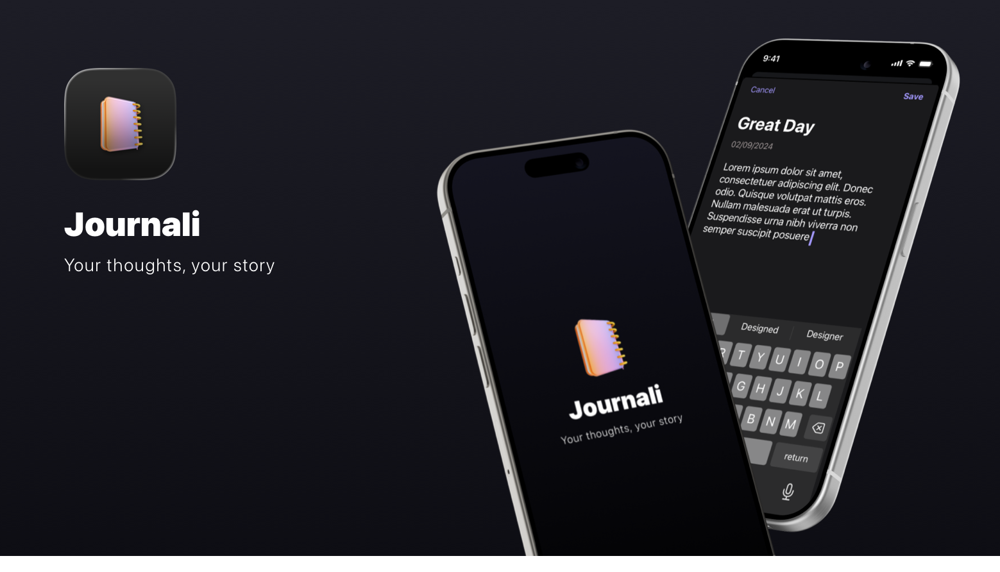

# Journali

Journali is a journaling app for iPhone where you can write, organize and revisit your personal diary entries. It has a dark, minimal design with liquid glass alerts, and your journals are saved on your device.

## Main features

- **Empty state** that guides you to write your first journal
- **Create and edit journals** with a title and free-form text
- **Bookmark** your favorite journals with one tap
- **Swipe to delete**, with a confirmation alert before anything is removed
- **Discard changes alert** that appears if you close the editor after typing
- **Search** journals by title or content
- **Sort** journals by entry date or by bookmark
- **Saved on your device**, so your journals are still there when you reopen the app

## Technologies used

- **Swift** and **SwiftUI**
- **Xcode**
- **Liquid Glass** (iOS 26) for the custom alerts
- **Sketch** for the UI design and design system (colors and SF Pro typography)

Made by Reema.
